<p align="center">
  
</p>

<p align="center">
  <a href="https://pypi.org/project/jzr-tools/"></a>
  <a href="https://pepy.tech/projects/jzr-tools"></a>
  <a href="https://pypi.org/project/jzr-tools/"></a>
  <a href="https://github.com/jzr-supove/jzr-tools/actions/workflows/ci.yml"></a>
  
  <a href="https://github.com/jzr-supove/jzr-tools/blob/main/LICENSE"></a>
  <a href="https://github.com/jzr-supove/jzr-tools/blob/main/docs/ai-agents.md"></a>
  <a href="https://jzr.tools"></a>
</p>

<p align="center">
  <b>Fast everyday jobs behind one command, <code>jzr</code>.</b><br>
  Convert images, video and audio, trim and compress media, make GIFs, edit audio tags,<br>
  work with PDFs and data files, free busy ports and clean up your machine.
</p>

<p align="center">
  <a href="#install">Install</a> ·
  <a href="#a-quick-tour">Quick tour</a> ·
  <a href="#documentation">Docs</a> ·
  <a href="#use-it-from-ai-agents">AI agents</a> ·
  <a href="https://jzr.tools">Web version</a>
</p>

<p align="center">
  
</p>

> **Prefer a browser?** [jzr.tools](https://jzr.tools) has web versions of many
> of these tools, plus some that need a screen, such as an image cropper and
> PDF signing.

## Why jzr

- **One install, one grammar.** Every tool is `jzr <thing> <action>`, the same
  on Windows, macOS and Linux.
- **Nothing else to install for most jobs.** Images (HEIC and AVIF included),
  PDFs, audio tags and data files work out of the box. Video and audio need
  ffmpeg, and `jzr ffmpeg install` fetches it into jzr's own folder.
- **Safe with your files.** Batch commands preview with `--dry-run`, write
  through a temporary file and never replace a file unless you pass
  `--overwrite`.
- **Quick to start.** Each call loads only the command it runs.
- **Ready for AI agents.** A skill and an MCP server let Claude Code, Codex,
  Cursor and others run `jzr` instead of writing their own scripts.

## Install

No Python needed. The installer sets up [uv](https://docs.astral.sh/uv/),
which downloads a suitable Python by itself, and then installs the `jzr`
command.

Windows (PowerShell):

```powershell
powershell -ExecutionPolicy ByPass -c "irm https://raw.githubusercontent.com/jzr-supove/jzr-tools/main/install.ps1 | iex"
```

macOS and Linux:

```bash
curl -LsSf https://raw.githubusercontent.com/jzr-supove/jzr-tools/main/install.sh | sh
```

If you already have uv or pipx:

```bash
uv tool install jzr-tools      # upgrade: uv tool upgrade jzr-tools
pipx install jzr-tools         # needs Python 3.11 or newer; upgrade: pipx upgrade jzr-tools
```

Open a new terminal afterwards and run `jzr --help`. Run the installer again
to upgrade. To try it without installing anything:
`uvx --from jzr-tools jzr --help`. Installing from source is described in
[docs/install.md](https://github.com/jzr-supove/jzr-tools/blob/main/docs/install.md).

## A quick tour

```bash
jzr image heic2jpg -d ~/Photos -r                 # every HEIC under a folder to JPEG
jzr image compress photo.jpg -s 500KB             # at most 500 kB
jzr image strip photo.jpg                         # drop EXIF and GPS, pixels untouched
jzr video compress clip.mov --for discord         # under Discord's 20 MB limit
jzr video gif clip.mp4 --start 1:05 --duration 4  # four seconds as a looping GIF
jzr audio tags song.mp3 -s artist=Band -s year=2020
jzr pdf merge a.pdf b.pdf c.pdf                   # a_merged.pdf, in the order given
jzr data convert config.yaml --to json
jzr file rename -d photos --template "{date}-{n:03}"   # a preview; add -y to rename
jzr killport 3000                                 # free a busy port
jzr host clean --dry-run                          # caches you could delete, and their size
jzr bind add tunnel ngrok http 5173               # then run it as: jzr tunnel
```

## What's inside

<p align="center">
  
</p>

<details>
<summary><b>Every command</b></summary>

| Command | What it does |
|---------|--------------|
| `jzr image convert` | Convert images between formats, one file or a whole directory |
| `jzr image <from>2<to>` | Shorthand for a format pair, e.g. `jzr image png2jpg` |
| `jzr image formats` | List supported extensions and the conversion engines available |
| `jzr image compress` | Make image files smaller, in their own format or another, optionally to a target size |
| `jzr image resize` | Make images smaller (or larger) by width, height, percentage or longest side |
| `jzr image strip` | Remove EXIF, GPS, XMP and other metadata from JPEG, PNG and WebP without re-encoding |
| `jzr image info` | Show an image's format, size, colour profile, camera, date taken and GPS position |
| `jzr pdf info` | Show the pages, paper sizes, metadata, text and features of PDF files |
| `jzr pdf merge` | Join PDF files into one, in the order given, keeping bookmarks |
| `jzr pdf split` | Split a PDF into one file per page, per N pages or per group of pages |
| `jzr pdf organize` | Reorder, rotate or remove the pages of a PDF |
| `jzr pdf compress` | Make PDFs smaller, mostly by shrinking their images to the size they are shown |
| `jzr pdf images` | Render the pages of a PDF as JPEG or PNG pictures |
| `jzr pdf from-images` | Make a PDF with one page per picture (JPEG, PNG, HEIC, WebP, ...) |
| `jzr pdf text` | Print the text of a PDF, or convert it to Markdown |
| `jzr video convert` | Convert video to mp4, mov, mkv or webm, take the sound out as audio, or make a GIF |
| `jzr video <from>2<to>` | Shorthand for a format pair, e.g. `jzr video mov2mp4` |
| `jzr video compress` | Make videos smaller as H.264 MP4, at a quality or under a size (`--size 25MB`) |
| `jzr video info` | Show the container, duration, size and streams of video files |
| `jzr video formats` | List video targets, the ffmpeg in use and which encoders it has |
| `jzr video trim` | Cut a time range out of video files, exactly or instantly from a keyframe |
| `jzr video gif` | Make a looping animated GIF of a video, or of part of it |
| `jzr audio convert` | Convert audio files to mp3, m4a, opus, ogg, flac or wav |
| `jzr audio <from>2<to>` | Shorthand for a format pair, e.g. `jzr audio wav2mp3` |
| `jzr audio info` | Show the format, streams and tags of audio files |
| `jzr audio formats` | List audio targets, the ffmpeg in use and which encoders it has |
| `jzr audio trim` | Cut a time range out of audio files without losing quality |
| `jzr audio tags` | Show or edit tags, cover art and lyrics of MP3, M4A, FLAC, Ogg and Opus files |
| `jzr ffmpeg install` | Download ffmpeg and ffprobe into jzr's own folder |
| `jzr ffmpeg status` | Show which ffmpeg and ffprobe jzr uses and where they come from |
| `jzr ffmpeg remove` | Delete the ffmpeg that `jzr ffmpeg install` downloaded |
| `jzr text slug` | Turn text into a URL-safe kebab-case slug, optionally dated and copied |
| `jzr text base64` | Encode text or a file as Base64, or decode it |
| `jzr text url` | Percent-encode or decode text for URLs, or show the parts of a URL |
| `jzr text diff` | Show how two text files differ, as a coloured unified diff |
| `jzr file rename` | Rename many files at once: replace text, change case, number them; previews first |
| `jzr uuid` | Generate UUIDs, version 4 or time-ordered version 7 |
| `jzr password` | Generate strong passwords or word passphrases |
| `jzr random` | Random numbers (`int`), picks (`pick`) or a shuffled list (`shuffle`) |
| `jzr hash` | Hash files or text, or check a `SHA256SUMS` list |
| `jzr timestamp` | Turn Unix time into dates and dates into Unix time, in any time zone |
| `jzr data json` | Pretty-print, minify, check or rewrite JSON, changing only whitespace |
| `jzr data convert` | Convert data between JSON, JSON Lines, YAML, CSV, TOML and Excel |
| `jzr jwt` | Show a JWT's header, payload and times, and check an HMAC signature |
| `jzr env example` | Turn a `.env` into a `.env.example`: the keys, without values |
| `jzr env compare` | List the keys only one of two `.env` files has; exit 1 if any |
| `jzr port show` | List listening ports and their processes, or show what uses given ports |
| `jzr port kill` | Force-kill the processes using one or more local ports |
| `jzr killport` | Shortcut for `jzr port kill` |
| `jzr host status` | Show host, CPU, memory, storage and GPU status |
| `jzr host clean` | Find caches and other disposable data, and remove what you pick |
| `jzr host procs` | Show what uses the most memory; optionally end what you pick |
| `jzr bind add` | Save a long command under a short name, run as `jzr <name>` |
| `jzr bind list` | List your shortcuts |
| `jzr bind remove` | Remove shortcuts |
| `jzr completion` | Set up tab completion for bash, zsh, fish or PowerShell, or print its script |
| `jzr agent` | Let AI agents use jzr: a skill for Claude Code, Codex and Cursor, or an MCP server |
| `jzr version` | Print the installed toolkit version |

</details>

<p align="center">
  
</p>

## Use it from AI agents

```bash
jzr agent install          # skills for Claude Code, Codex and Cursor
jzr agent install --mcp    # plus an MCP server, for apps without a shell
```

Or, in Claude Code, add the plugin from this repository:

```
claude plugin marketplace add jzr-supove/jzr-tools
claude plugin install jzr@jzr-tools
```

<p align="center">
  
</p>

The MCP server needs the `mcp` extra; which client gets what, and what each
tool may change, is in
[docs/ai-agents.md](https://github.com/jzr-supove/jzr-tools/blob/main/docs/ai-agents.md).

## Documentation

| Topic | Covers |
|---|---|
| [Install](https://github.com/jzr-supove/jzr-tools/blob/main/docs/install.md) | Installers, uv, pipx, upgrading, installing from source |
| [Images](https://github.com/jzr-supove/jzr-tools/blob/main/docs/images.md) | `convert`, `resize`, `compress`, `strip`, `info` |
| [Video and audio](https://github.com/jzr-supove/jzr-tools/blob/main/docs/video-audio.md) | Getting ffmpeg, `convert`, `compress`, `trim`, `gif`, audio tags |
| [PDF](https://github.com/jzr-supove/jzr-tools/blob/main/docs/pdf.md) | `merge`, `split`, `organize`, `compress`, `images`, `from-images`, `text` |
| [Text and data](https://github.com/jzr-supove/jzr-tools/blob/main/docs/text-and-data.md) | Slugs, Base64, URLs, diffs, timestamps, JSON, data conversion, JWTs, `.env` files, generators, hashes |
| [Renaming files](https://github.com/jzr-supove/jzr-tools/blob/main/docs/files.md) | `jzr file rename` |
| [Ports and your machine](https://github.com/jzr-supove/jzr-tools/blob/main/docs/system.md) | `port show`, `killport`, Windows excluded ports, `host status`, `host clean`, `host procs` |
| [Shortcuts](https://github.com/jzr-supove/jzr-tools/blob/main/docs/shortcuts.md) | `jzr bind`: save long commands under short names |
| [Shell completion](https://github.com/jzr-supove/jzr-tools/blob/main/docs/completion.md) | Tab completion for bash, zsh, fish and PowerShell |
| [AI agents](https://github.com/jzr-supove/jzr-tools/blob/main/docs/ai-agents.md) | The skill, the MCP server and the Claude Code plugin |

Every command also explains itself: `jzr -h`, or `-h` after any group or
command.

## Contributing

Pull requests are welcome. See [CONTRIBUTING.md](https://github.com/jzr-supove/jzr-tools/blob/main/CONTRIBUTING.md)
for how a tool is laid out, how to add one and how to run the tests.

## License and credit

`jzr-tools` is created by JZR SUPOVE and released under the
[Apache License 2.0](https://github.com/jzr-supove/jzr-tools/blob/main/LICENSE).
You may use, change and redistribute it, including in commercial products.
When you redistribute it or a work based on it, keep the
[NOTICE](https://github.com/jzr-supove/jzr-tools/blob/main/NOTICE) file with
its credit line, as section 4 of the license asks.

`jzr password -w` uses the [EFF Long Wordlist](https://www.eff.org/dice) by
Joseph Bonneau for the Electronic Frontier Foundation, under
[CC BY 4.0](https://creativecommons.org/licenses/by/4.0/). The words are
unchanged; only the dice numbers were removed. EFF does not endorse jzr.
