# Using jzr from AI agents

[← jzr-tools](../README.md) · [Install](install.md) · [Images](images.md) · [Video and audio](video-audio.md) · [PDF](pdf.md) · [Text and data](text-and-data.md) · [Files](files.md) · [Ports and host](system.md) · [Shortcuts](shortcuts.md) · [Completion](completion.md) · [AI agents](ai-agents.md)




Agents that can run commands need only the skill. The MCP server is for programs
without a shell, such as Claude Desktop.

| Client | Skill | MCP server |
|---|---|---|
| Claude Code | `jzr agent install`, or the plugin (from 0.3.0) | `jzr agent install --mcp`, or the plugin |
| Codex | `jzr agent install` | `jzr agent install --mcp` |
| Cursor | `jzr agent install` | the entry or link that `--mcp` prints |
| VS Code / Copilot | – | `jzr agent install --mcp` (when `code` is on PATH) |
| Claude Desktop | – | the entry that `--mcp` prints |
| Gemini CLI, Antigravity, Devin, Goose | read `~/.agents/skills`: `jzr agent install --agent codex` | their own MCP settings |
| Zed, Cline and others | – | the usual `mcpServers` JSON, with `jzr agent mcp` as the command |

For one Claude Code, use either the plugin or `jzr agent install`, not both:
it would see two copies of the skill and two servers.

The plugin comes from this repository's marketplace:

```
claude plugin marketplace add jzr-supove/jzr-tools
claude plugin install jzr@jzr-tools
```

It starts the server with `uvx`, so it needs [uv](https://docs.astral.sh/uv/)
but no installed jzr.

## Skill

```
jzr agent install
```

installs a skill: a short guide that tells an AI agent which jzr command does a
job, so it runs `jzr` instead of writing its own script. Agents keep only its
name and description in mind until a task needs it.

| Agent | Where the skill goes |
|---|---|
| Claude Code | `~/.claude/skills/jzr` |
| Codex | `~/.agents/skills/jzr` |
| Cursor | Reads either; alone, it gets `~/.agents/skills/jzr` |

- It is installed for every agent whose folder (`~/.claude`, `~/.codex` or
  `~/.cursor`) exists. `--agent claude` or `--agent codex` picks one, found or
  not.
- `--project` uses the current folder instead: `.claude/skills/jzr`, or
  `.agents/skills/jzr` with `--agent codex`.
- A copy that you changed, that a newer jzr installed, or that jzr did not
  install is left alone unless you add `--overwrite`. `--dry-run` only shows
  what would happen.
- After upgrading jzr, run `jzr agent install` again.
- `jzr agent remove` takes the skill out again, and `jzr agent skill` prints it
  (`--path`: its folder in the package).

The guide tells agents to leave `jzr host clean`, `jzr host procs --kill` and
`jzr ffmpeg install` to you, and to ask before they change your setup.

## MCP server

The server needs an extra that is not installed by default:

```
uv tool install "jzr-tools[mcp]"      # or: pipx install "jzr-tools[mcp]"
jzr agent install --mcp
```

`--mcp` installs the skill as above and then sets up the server for your user:

- Claude Code, Codex and VS Code are told through their own command lines
  (`claude mcp add`, `codex mcp add`, `code --add-mcp`). One that is not on
  PATH is skipped; Claude Code gets the command to run later.
- For Cursor and Claude Desktop it prints the entry to add, and for Cursor also
  a link that adds it. jzr does not edit their settings files itself. In Claude
  Desktop: Settings > Developer > Edit Config, paste it and restart the app.
- `--client claude`, `codex`, `vscode`, `cursor` or `desktop` handles only that
  one. `--dry-run` shows the commands instead of running them.

`jzr agent remove --mcp` takes the server out of Claude Code and Codex again and
says where to remove it by hand elsewhere. Any other MCP client can start the
server with `jzr agent mcp`, which talks over stdin and stdout.

| Tools | What they can do |
|---|---|
| Read only | `image_info`, `pdf_info`, `pdf_text` (prints only), `video_info`, `audio_info`, `audio_tags`, `hash`, `data_json`, `text_diff`, `file_rename` (a preview), `port_show`, `host_status` and others: look and answer, change nothing |
| New files only | `image_compress`, `image_convert`, `image_resize`, `image_strip` (without `--in-place`), `pdf_merge`, `pdf_split`, `pdf_organize`, `pdf_compress`, `pdf_images`, `pdf_from_images`, `data_convert`, `video_compress`, `video_convert`, `video_trim`, `video_gif`, `audio_convert`, `audio_trim`: have no `--overwrite`, so a file that exists is never replaced |
| Destructive | `file_rename_apply`, `audio_tags_edit`, `port_kill`: marked as such, so a client can ask you first |

- The options of a command are the arguments of its tool: `--max-side` is
  `max_side`. Relative paths count from the folder the client started the server
  in, so agents are told to use absolute paths.
- One tool runs at a time. A long encode keeps the others waiting, and a client
  may stop waiting for it; run big jobs in a shell.
- A result longer than 20,000 characters is cut at a line and says so.
- `jzr host clean`, `jzr ffmpeg install` and `remove`, `jzr bind` and
  `jzr completion` are not offered, and `host_procs` cannot end anything.
